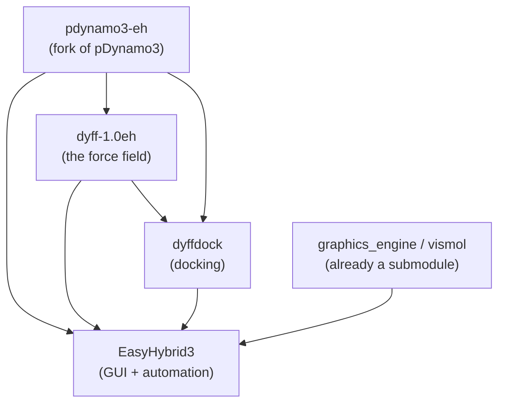

# Split into 4 repositories — report (2026-11-15)

EasyHybrid, DYFF-1.0eh, DYFFDock and the pDynamo3 fork each used to live inside one
repository (`EasyHybrid3`). This splits them into 4 repositories, connected as git
submodules, so each can be versioned, cited and reused on its own — DYFF-1.0eh in
particular needs to be installable and testable without the GUI for the method papers.

## Dependency graph



| Repository | Visibility | URL | Tag at this report |
|---|---|---|---|
| `pdynamo3-eh` | public | github.com/ferbachega/pdynamo3-eh | `v1.0.0-eh` (+1 docs commit) |
| `dyff-1.0eh` | private | github.com/ferbachega/dyff-1.0eh | `v1.1.0` (+1 docs/examples commit) |
| `dyffdock` | private | github.com/ferbachega/dyffdock | `v0.1.1` |
| `EasyHybrid3` | public | github.com/ferbachega/EasyHybrid3 | `v3.2.0` (tag marks the *pre-split* state) |

## Order of extraction (lowest-risk first)

1. **dyffdock** — already had zero GUI dependency; a near-mechanical move.
2. **pdynamo3-eh** — forked `pdynamo/pDynamo3`, reconciled EasyHybrid's own
   accumulated patches (two divergent copies: an uncommitted local install and a
   separate `src/util/extras/` tree), rebuilt it, switched EasyHybrid to depend on
   it as a submodule.
3. **dyff-1.0eh** — the force field itself. Required first finding and fixing the
   last 2 places it reached into GUI-only code, and discovering that
   `pdynamo/opls/{prep,ligand}.py` were not OPLS-specific at all (see below).
4. **install.py** updated for the new architecture (submodule build steps,
   `--profile {ff,dock,full}`).
5. **This step**: DYFF-1.0eh's own methodology docs and a standalone example moved
   into its repository.

## Folder structure

### `dyff-1.0eh` (private)

```
dyff-1.0eh/
├── pyproject.toml, README.md, LICENSE
├── pdynamo/                       <- package name kept as "pdynamo" on purpose, see below
│   ├── dyff_edits.py              parameter-set switch, the override mechanism over
│   │                              pDynamo3's rule-based DYFF factories, polar-H/TIP3P LJ
│   ├── dyff_prep.py               whole-system DYFF preparation
│   ├── residue_library.py         force-matched residue library, charges, torsion scans
│   ├── structure_prep.py          force-field-agnostic system/ligand analysis & building
│   ├── ligand_chemistry.py        force-field-agnostic ligand chemistry perception
│   ├── ligand_perception.py       native (RDKit/OpenBabel-free) ligand chemistry
│   ├── bond_order_perception.py   Wang & Case algorithm (vendored from vismol, see below)
│   ├── metal_geometry.py / metal_refine.py   transition-metal geometry + Hessian refinement
│   ├── seminario.py               Hessian-compliance bond/angle/out-of-plane fitting
│   ├── bond_library.py / dyff_bond_fit.py / torsion_fit.py   calibration pipeline + fitting
│   ├── esp_charges.py             CM5/RESP/ESP charges
│   ├── env_codes.py               RDKit-free atom-environment code
│   ├── mol2_import.py             fallback MOL2 reader
│   ├── subsystem.py               capped subsystems (torsion-scan fragments, selections)
│   ├── param_logs.py              keeps original xtb/ORCA outputs
│   ├── data/                      bond/angle/hessian/residue libraries (JSON) + the
│   │                              dyff-1.0-eh atom-type/pattern set (native pDynamo format)
│   └── pdb_components_extra/      PDB component library entries pDynamo3 lacks
├── examples/dyff_prep_bachega/    standalone worked example (see below)
├── docs/                          methodology reports moved in this step (see below)
└── tests/                         7 files, runs with NO EasyHybrid on sys.path at all
```

### `pdynamo3-eh` (public) — fork of `pdynamo/pDynamo3`

Same tree as upstream pDynamo3 (`pCore`, `pMolecule`, `pBabel`, `pScientific`,
`pSimulation`, `parameters`, `installation`, ...) plus `docs/IMPLEMENTATION_NOTES.md`,
which records every patch reconciled into it and the bugs found in the process.

### `dyffdock` (private)

```
dyffdock/
├── pyproject.toml, README.md, LICENSE
├── dyffdock/            search/, scoring/, growth/, library/, docking.py, receptor.py, ...
├── examples/1dy4/        a worked redocking example
├── validation/           LAB_NOTEBOOK.md + the docking benchmark report/scripts
└── tests/
```

### `EasyHybrid3` — `src/` after the split

```
src/
├── graphics_engine/   (submodule — vismol, already existed)
├── pdynamo3-eh/        (submodule — new)
├── dyff-1.0eh/         (submodule — new)
├── dyffdock/           (submodule — new)
├── pdynamo/            <- only the GUI-coupled bridge code now (shares the "pdynamo"
│   ├── pDynamo2EasyHybrid/   namespace with dyff-1.0eh's pdynamo/, see below)
│   ├── p_methods/
│   ├── opls/           OPLS-AA-specific tail (type_atoms, prepare_opls_system, ...)
│   ├── us_data.py, subsystem_*, LogFileWriter.py, param_report.py, mm_inspect.py,
│   └── solvate_system.py, excited_states.py
├── gui/, automation/, util/, remote/
```

## Why the package is still called `pdynamo` (not renamed to e.g. `dyffeh`)

Every EasyHybrid call site (GUI windows, the terminal, the automation API) already
imports this code as `pdynamo.dyff_edits`, `pdynamo.residue_library`, etc. — hundreds of
references. Renaming would have meant touching every one of them for no functional
benefit. `src/pdynamo/` already had no `__init__.py`, which makes it a
[PEP 420](https://peps.python.org/pep-0420/) implicit namespace package: as long as
`dyff-1.0eh`'s own `pdynamo/` is also on `sys.path` and also has no `__init__.py`, Python
merges the two into **one** `pdynamo` namespace automatically. Installed standalone with
no EasyHybrid around, `pdynamo` simply resolves to `dyff-1.0eh`'s copy alone — confirmed
with a 2-line smoke test before committing to the design.

## Real bugs found — not just moved code

Each item below changed a result, was confirmed against real input, and would have
shipped silently wrong if the extraction had been done by code review alone.

1. **MOL2 reader: an AMBER-style oxygen type read as Osmium.** Reconciling
   `pBabel/MOL2FileReader.py` against upstream's newer rewrite, `AtomicNumberFromAtomType`'s
   fallback tried `PeriodicTable.AtomicNumber` on the bare type string — type `"OS"`
   (an ether/ester oxygen) matched element symbol **Os** (Osmium). Confirmed on a real
   ligand file (`valacyclovir.mol2`, Gabedit-written). Fixed in `pdynamo3-eh`.
2. **MOL2 reader: a broken `SUBSTRUCTURE`/`ATOM` mismatch crashed instead of falling
   back.** When the two sections disagree on a residue's name (also seen on the same
   file), the code already detected it and warned, but left a *partial* result that
   then crashed downstream instead of degrading gracefully. Fixed in `pdynamo3-eh`.
3. **Silent degradation to a worse bond-order perception with no GUI present.**
   `ligand_perception.py`/`ligand_chemistry.py` reached `vismol.core.
   bond_order_perception.perceive_bond_orders` (a pure graph algorithm, no graphics
   dependency at all) through a path trick relative to EasyHybrid's graphics_engine
   submodule. Standalone, that path does not exist, the import silently failed, and a
   cruder fallback gave the **wrong deprotonation state for a plain carboxylic acid**
   in testing — no error raised. Fixed by vendoring the algorithm itself into
   `dyff-1.0eh/pdynamo/bond_order_perception.py` (pure stdlib).
4. **`EXAMPLES = ("1BX4.pdb")` has no trailing comma.** It is the string `"1BX4.pdb"`,
   not a 1-tuple; `for f in EXAMPLES` iterated over its characters. Pre-existing in
   EasyHybrid's own copy too (never run with no arguments before); fixed in both.
5. **Undeclared dependencies**: `networkx` (hard import in `residue_library.py`,
   missing from `requirements.txt`) and `PyYAML` (needed to build `pdynamo3-eh` itself
   and by `ligand_chemistry.py` at runtime) — both only worked by accident, because
   they happened to already be installed on this machine.
6. **Unrelated, found incidentally**: `pMolecule/QCModel/QCDispersionModelDFTD2.py` has
   been syntactically broken since `pdynamo/pDynamo3`'s first commit (a malformed
   docstring, two unclosed parentheses) — never importable in any install. Only the
   syntax was fixed; the class also has a missing import and a missing `return`, not
   touched (never exercised, needs real testing against DFT-D2 behaviour to fix safely).

## Architectural finding: `pdynamo/opls/{prep,ligand}.py` were not OPLS-specific

`dyff_prep.py`/`residue_library.py`/`torsion_fit.py` turned out to depend on real logic
in these two files, not trivial helpers — `prep.py`'s own header already said *"types
nothing with OPLS"*. Traced every call site (not guessed) and split each file:

- **Generic** (moved to `dyff-1.0eh`): `pdynamo/structure_prep.py` (residue/ligand/metal
  site analysis, system building — `analyze_system`, `build_prepared_system`,
  `write_clean_pdb`, `ligand_preview`, ...) and `pdynamo/ligand_chemistry.py` (hydrogens
  at a pH, bond orders, Kekulization, formal charges).
- **OPLS-AA-specific** (stayed in EasyHybrid's `src/pdynamo/opls/`): atom-class
  assignment, Lennard-Jones per class, `prepare_opls_system`, `type_atoms`.

Both trimmed files re-export every name their real callers use (checked by grepping the
full `pdynamo.opls.{prep,ligand}` access surface across all of `src/`, not a sample), so
no existing call site needed to change.

## Validation performed (not just reviewed)

- `dyff-1.0eh`'s own test suite, run with **no EasyHybrid checkout on `sys.path` at
  all** (only `pdynamo3-eh` + itself): 99 passed, 6 failed — every failure a confirmed,
  expected dependency on EasyHybrid-only code deliberately left behind
  (`pdynamo.opls`, one test's `util.pdb_tools` import, 3 tests needing the separate
  `fraglib` project), not a bug.
- EasyHybrid3's own full suite: **252 passed** after each of the 4 extraction steps.
- `examples/dyff_prep_bachega/prepare_dyff_eh.py` run for real, standalone, against the
  bundled `1BX4.pdb` (a Zn metalloprotein with an ADN ligand): 6520 atoms after
  preparation, 342/344 residues matched by the library, CM5 charges computed for the 64
  remaining atoms, 12 guanidinium groups corrected, energy -13255.07 kcal/mol,
  reproduced exactly after a save/load (Pickle) round-trip.
- `pdynamo3-eh`'s build verified by actually importing `pCore`/`pBabel`/`pMolecule`
  afterwards, not just checking the build command's exit code (same pattern already
  used for the vismol submodule).

## `install.py` updated for the new architecture

- `init_submodules()`: `git submodule update --init --recursive` + reports which of the
  4 submodule directories are actually non-empty (a plain `git clone` without
  `--recursive` leaves them present but empty).
- `build_pdynamo3_eh()`: replaces locating a separately installed pDynamo3; builds the
  submodule and verifies the import, mirroring `install_vismol()`.
- `check_dyff_1_0eh()` / `check_dyffdock()`: sanity-import checks (pure Python, no
  build step).
- The old flow (`check_pdynamo()` + `install_qc_modules()`, copying QC-engine files into
  a separately installed pDynamo3) is kept, but only runs when a personal `paths.py`
  already points elsewhere.
- `--profile {ff,dock,full}` (default `full`): `ff` builds only `pdynamo3-eh` +
  `dyff-1.0eh` (scripting/HPC use of the force field, no GUI needed); `dock` adds
  `dyffdock`; `full` adds VISMOL, QC engine configuration and the desktop shortcut.

## Update (2026-11-19)

- `dyff-1.0eh` is now **public** (github.com/ferbachega/dyff-1.0eh).
- `init_submodules()` was fetching all 4 submodules unconditionally (`git submodule
  update --init --recursive` with no path filter), regardless of `--profile` -- so even
  `ff`/`full` hit the private `dyffdock` repo and failed/prompted for credentials for
  anyone without access. It now fetches only the submodules the chosen profile needs
  (`PROFILE_SUBMODULES`); `dyffdock` is pulled in only for `--profile dock` or the new
  `--with-dyffdock` flag on top of any profile. `dyffdock` stays private.
- `menuitem_run_dyffdock` (Extras > Run DYFFDock) now catches the `ImportError` and shows
  a dialog pointing at `--with-dyffdock` instead of crashing when the submodule is absent.

## Known follow-ups (not done, not blocking)

- `install.py` has not been tested end to end from a genuinely fresh clone.
- `dyffdock` is still private; decide when (paper submission/acceptance) to make it
  public.
- The manifest-vs-submodule question was settled in favour of submodules (matches the
  existing vismol pattern); a migration path to a version-range + lockfile model was
  discussed and remains possible later without disruption.
- `SER`/`THR`/`LYS` χ1 regression without the force-matched override (flagged 2026-11-08,
  unrelated to this split) is still open.
