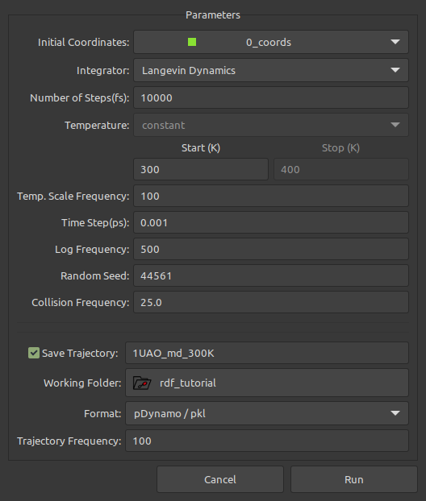
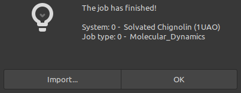
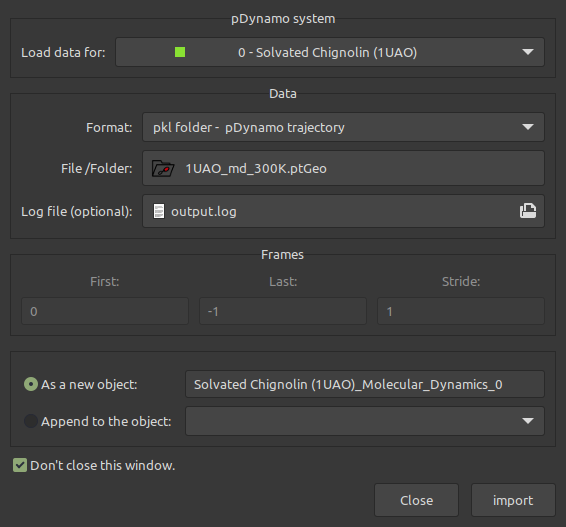
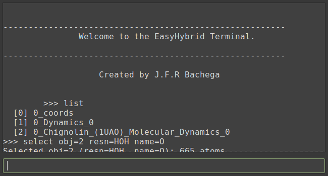
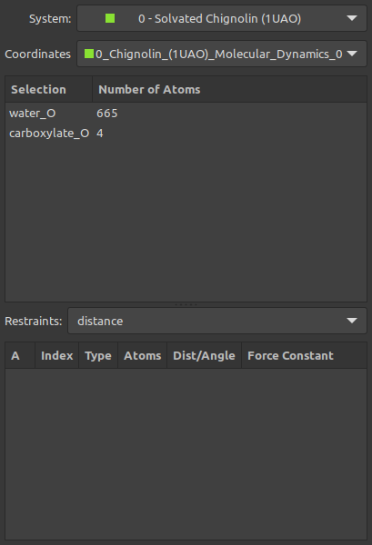
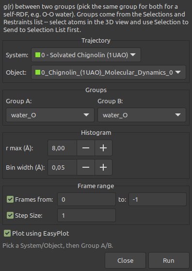
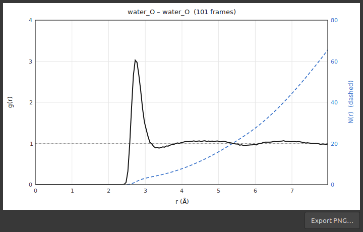
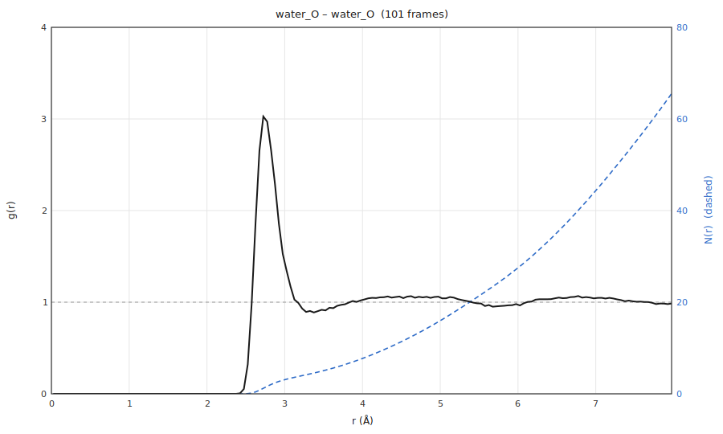
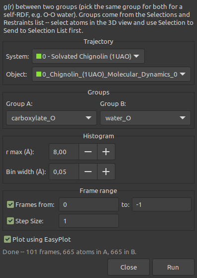
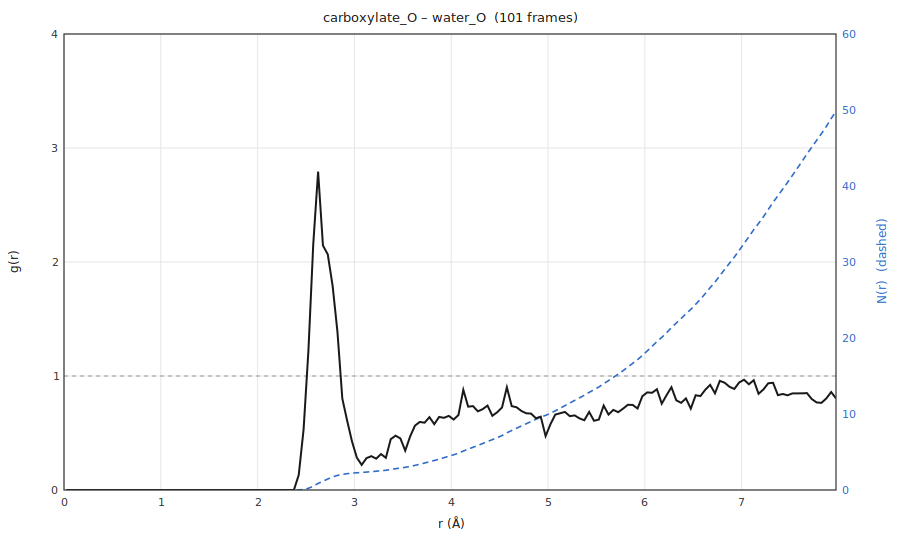

# Radial distribution functions g(r) in EasyHybrid: solvated chignolin (1UAO)

> Draft, 2026-10-21. The figures were made with the current development version of EasyHybrid
> (they show the new g(r) plot of the RDF window, not the one in 3.1.3).

This tutorial computes two radial distribution functions from a short molecular dynamics run of
chignolin (PDB 1UAO, a 10-residue β-hairpin) in a box of water:

1. water oxygen – water oxygen, the classic g(r) of liquid water;
2. carboxylate oxygens of Asp3 and Glu5 – water oxygen, the hydration shell of the charged side chains.

The whole tutorial takes about 5 minutes; the MD run itself about 2.5 minutes on one CPU core.

## What g(r) is

g(r) is the density of B atoms found at distance r from an A atom, divided by the average density
of B in the box. g(r) = 1 means "as in the bulk"; a peak means a preferred distance (a solvation
shell); g(r) = 0 means no pairs at that distance.

The window also gives the running coordination number N(r), the average number of B atoms within
r of an A atom. N(r) at the first minimum of g(r) is the number of neighbours in the first shell.

g(r) needs a periodic box: the density is taken from the box volume of each frame, and distances
use the minimum image.

---

## 1. Load the solvated system

**File → Open** and choose `examples/tutorials/04_md_basics/1UAO_OPLS_folded_solvated.pkl` from the EasyHybrid
folder.

| | |
|---|---|
| Atoms | 2135 (chignolin, 665 water molecules, 2 Na⁺) |
| Force field | OPLS-AA |
| Box | cubic, 28 Å, periodic boundary conditions |
| Nonbonded model | cut-off |

The status bar at the bottom of the main window shows these properties (`force field: OPLS`,
`PBC: True`, `symmetry: Cubic`).

## 2. Run a short MD simulation

**Simulate → Molecular Dynamics**. Fill in the window as in Figure 1:

| Field | Value | Why |
|---|---|---|
| Initial Coordinates | `0_coords` | the structure just loaded |
| Integrator | Langevin Dynamics | keeps the temperature at 300 K |
| Number of Steps | 10000 | 10 ps with a 1 fs step |
| Temperature (Start) | 300 K | |
| Time Step (ps) | 0.001 | 1 fs (pDynamo has no SHAKE) |
| Log Frequency | 500 | one line in the log every 0.5 ps |
| Collision Frequency | 25.0 ps⁻¹ | Langevin friction |
| Save Trajectory | on, name `1UAO_md_300K` | |
| Format | pDynamo / pkl | |
| Trajectory Frequency | 100 | one frame every 0.1 ps, 101 frames |


*Figure 1. Molecular Dynamics window for the 10 ps run.*

Click **Run**. The job runs in the background; its progress is in the Process Manager. In our run
the average temperature was 296 ± 5 K.

> **10 ps is enough for this tutorial, not for a study.** The run starts from the stored structure
> without equilibration. For publishable g(r), equilibrate first and analyse a longer production
> run (hundreds of ps or more), with more frames.

## 3. Import the trajectory

When the job finishes, the **Finished!** dialog appears (Figure 2). Click **Import...**: the
**Import Data** window opens already filled in with the job's trajectory (`1UAO_md_300K.ptGeo`,
format *pkl folder – pDynamo trajectory*) and its log (Figure 3). Click **import**.


*Figure 2. The Finished! dialog. Import... opens the Import Data window for this job.*


*Figure 3. Import Data, pre-filled with the MD trajectory.*

A new object, `…_Molecular_Dynamics_0`, appears under the system in the object list, with 101
frames (column F). Its frames keep the periodic box, which the RDF needs. (The MD run also adds an
object with only its last frame, `0_Dynamics_0`; it is not used here.)

## 4. Define the two groups of atoms

The RDF window takes its groups A and B from the system's selection list (**Selection → Selections
and Restraints**). The quickest way to select every water oxygen is the EasyHybrid Terminal.

1. **View → EasyHybrid Terminal**.
2. Type `list` to see the object numbers. The trajectory is object 2 here.
3. Select the water oxygens:
   ```
   select obj=2 resn=HOH name=O
   ```
   The terminal answers `665 atoms` (Figure 4).
4. **Selection → Send to Selection List**. The selection is stored as `sel_0`.
5. Select the four carboxylate oxygens (Asp3 OD1/OD2 and Glu5 OE1/OE2) and send them too
   (`sel_1`):
   ```
   select obj=2 resn=ASP,GLU name=OD1,OD2,OE1,OE2
   ```
6. Give the selections meaningful names: in **Selection → Selections and Restraints**, right-click
   a selection, choose **Rename**, type the new name and press Enter. We used `water_O` and
   `carboxylate_O` (Figure 5).
7. Type `deselect` in the terminal to clear the highlight in the 3D view.


*Figure 4. Selecting the 665 water oxygens in the EasyHybrid Terminal.*


*Figure 5. The two groups in the selection list, after renaming.*

The terminal filters combine (AND): `chain=`, `resi=` (ranges such as `10-20`), `resn=`, `name=`
and `symbol=` (element), each accepting comma-separated values, plus `not_…` versions to exclude
atoms. `help select` lists them.

## 5. Water oxygen – water oxygen g(r)

**Analysis → RDF Analysis (g(r))** (Figure 6):

| Field | Value |
|---|---|
| System / Object | the solvated chignolin / the MD trajectory (`…_Molecular_Dynamics_0`) |
| Group A | `water_O` |
| Group B | `water_O` (the same group: each atom is not counted as its own neighbour) |
| r max | 8 Å (keep it below half the box length, 14 Å here) |
| Bin width | 0.05 Å |
| Frame range | all frames (0 to −1), step 1 |
| Plot using EasyPlot | on |


*Figure 6. RDF Analysis window for the water O–O g(r).*

Click **Run**. Two windows open: a table with r, g(r) and N(r) for every bin (it can be saved as
text), and the plot (Figure 7). Moving the mouse over the plot shows the values under the cursor;
**Export PNG…** saves the figure (Figure 8 was made this way).


*Figure 7. The g(r) plot window: g(r) (solid, left axis) and N(r) (dashed, right axis).*


*Figure 8. Water oxygen – water oxygen g(r) over 101 frames (10 ps).*

What the curve shows:

| | This run | Liquid water, experiment |
|---|---|---|
| First peak | 2.73 Å, g = 3.0 | 2.8 Å, g ≈ 2.5 |
| First minimum | 3.38 Å | ≈ 3.4 Å |
| N(r) at the first minimum | 4.5 | ≈ 4.3–4.7 |

Each water molecule has about four nearest neighbours, the hydrogen-bonded tetrahedral shell. The
first peak is higher than in experiment, as is usual for TIP3P-type water models; beyond 4 Å, g(r)
oscillates around 1.

## 6. Carboxylate oxygen – water oxygen g(r)

In the same window change **Group A** to `carboxylate_O` (keep Group B = `water_O`) and click
**Run** again (Figure 9).


*Figure 9. Group A changed to the carboxylate oxygens.*


*Figure 10. Carboxylate oxygen (Asp3, Glu5) – water oxygen g(r).*

| | This run |
|---|---|
| First peak | 2.63 Å, g = 2.8 |
| First minimum | 3.08 Å (g = 0.2) |
| N(r) at the first minimum | 2.3 water molecules per carboxylate oxygen |

The first peak is closer than in bulk water (2.63 against 2.73 Å) and is followed by a deep
minimum: the waters hydrogen-bond strongly to the charged carboxylate and form a well-defined
shell. Beyond the first shell g(r) stays below 1, because part of the space around a side-chain
oxygen is taken by the peptide itself, not by water.

The curve is noisier than the water O–O one: group A has 4 atoms instead of 665. More frames
(a longer run) smooth it.

---

## Notes

- **Same group in A and B** (self-RDF): an atom is not counted as its own neighbour. Two different
  groups that only partly overlap are not treated specially.
- **r max** must stay below half the shortest box length, or the minimum-image distances are wrong.
- **Frames from / Step Size**: skip the first frames (equilibration) or use every n-th frame for a
  long trajectory.
- **No box**: if the object has no periodic cell, the window says so; g(r) cannot be normalised
  without a volume.
- **Other force fields**: the analysis only reads coordinates and the box, so it works the same for
  AMBER, CHARMM, OPLS or DYFF trajectories, as long as the imported frames carry the periodic box.
